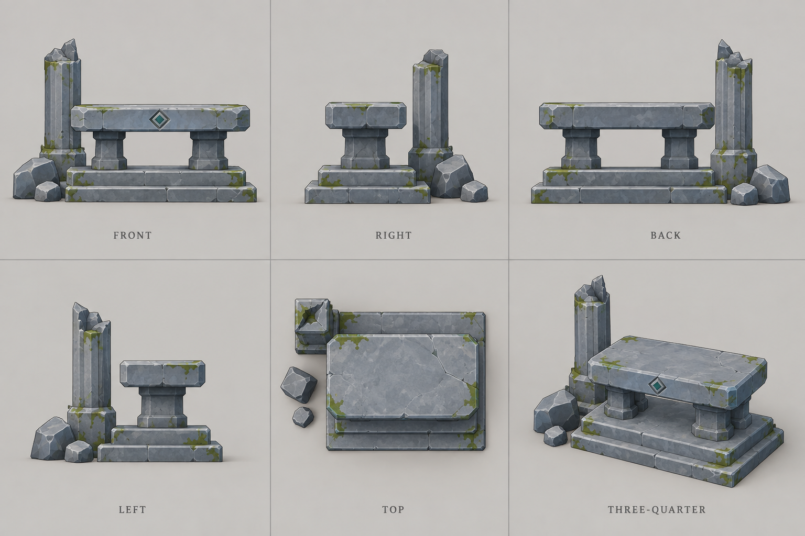
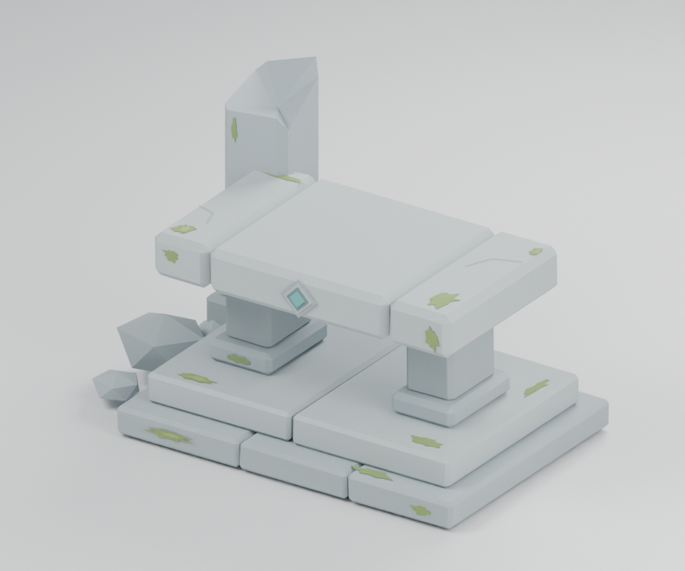

# 버려진 제단 모델 교체

## 기존 소품 추가 작업

- [x] 기존 에셋 목록과 모델 카탈로그 확인: SwordTool 선택
- [x] 기존 검을 상판 위에 눕혀 배치하고 클릭 표면 연결
- [x] 프리팹 저장 및 C# 빌드 확인

새 모델 생성 없이 기존 `SwordTool.fbx`를 봉헌된 검 소품으로 재사용한다.

검의 은색 칼날과 황동 장식을 유지하며 상판 중앙에 대각선으로 눕힌다. 검의 실제 정점 최저점을 상판 높이에 맞추고 기존 표면 클릭 피드백을 연결한다. 위치·회전 변경은 새 제단 프리팹의 `OfferingSword` 자식에서 관리한다. 검 원본 FBX와 Blender 모델은 수정하지 않는다. 앞서 제작한 Blender 미리보기에는 이 Unity 배치 소품이 포함되지 않는다.

배치 코드 C# 빌드 통과. 2026-09-20 에디터에서 프리팹 저장 완료를 [배치 결과](altar-offering-unity.json)와 실제 프리팹의 OfferingSword 자식으로 확인했다. After의 연결된 프리팹에 반영된다. Play 시각 검증은 실행하지 않았다.

## 작업 목록

- [x] ImageGen으로 동일 제단의 정면·좌우·후면·상면·사선 시안 생성
- [x] 시안을 기준으로 편집 가능한 Blender 모델 제작
- [x] 정면·측면·사선 렌더로 실루엣과 표면 확인
- [x] FBX 내보내기와 Unity 재질·클릭 표면·프리팹 연결
- [x] After 제단 교체 및 기존 모델 비교 보존
- [x] C# 빌드와 제작/리소스 기록 갱신

## 방향

넓은 돌 상판, 두 개의 낮은 받침, 두 단의 기단, 한쪽의 부서진 사각 기둥으로 작은 화면에서도 제단이 읽히도록 만든다. 청회색 돌과 드문 이끼, 작은 청록 마름모 장식으로 기존 숲에 맞춘다. 큰 수정이 있는 아치형 Ruins는 별개 구조물이며 이번 교체 대상이 아니다.

원본 모델과 공유 프로토타입 소비자를 보존하고 After 공간의 AbandonedAltar만 새 모델을 사용한다. Before/Process는 유지한다.

## 경로

- [6방향 생성 시안](../../res/concepts/abandoned-altar-v2/turnaround.png)
- [실제 사용한 ImageGen 프롬프트](../../res/concepts/abandoned-altar-v2/prompt.txt): 내장 ImageGen 도구 사용
- [Blender 원본](../../res/art-source/world/abandoned-altar-v2/AbandonedAltarV2.blend)
- [제작 코드](../../tools/art/build_abandoned_altar_v2.py), [렌더 전용 코드](../../tools/art/render_altar_views.py)
- [엔진 비의존 FBX](../../res/models/world/AbandonedAltarV2.fbx)
- [Unity FBX](../../impls/unity/Afterlife/Assets/Devlog/Day01/Models/AbandonedAltarV2.fbx)
- [Unity 프리팹](../../impls/unity/Afterlife/Assets/Devlog/Day01/Prefabs/Environment/AbandonedAltarV2.prefab)

## 시안과 실제 모델

생성 이미지는 형태 참고용이며 모델 자체는 Blender 메시로 제작했다. 작은 게임 화면에 맞춰 표면의 잔무늬는 단순화했다. Blender의 스튜디오 조명과 게임 조명은 다르므로 실제 게임의 색·그림자 체감은 Unity에서 확인한다.

## 제작 사양

|항목|값|
|---|---|
|원본 편집 부품|48개 메시, 부품별 이름 유지|
|Unity 내보내기|통합 메시 1개 / 렌더러 1개 / 재질 1개|
|삼각형|1,338개|
|원본 크기|너비 2.270m × 깊이 1.388m × 높이 1.530m|
|After 배치|기존 제단 피벗 (0.1, 0, 2.1), 새 모델 배율 0.84|
|색상|정점색 팔레트, 청회색 돌과 이끼, 비발광 청록 상감|
|그림자|기존 실시간 조명 사용, 그림자 텍스처 베이크 없음|
|선택|전용 표면 데이터와 ShowcasePickSurface로 클릭·교차점 색 피드백 연결|

FBX에 스튜디오 카메라·조명·바닥은 넣지 않는다. Blender 원본의 `Altar_EditableParts`에 실제 부품, `PreviewStudio_NotExported`에 렌더 환경을 분리했다.

## 확인 및 비교

`Devlog_Day01` 씬의 After → Environment → AbandonedAltar_Pivot 아래 새 `AbandonedAltarV2`가 활성화되어 있다. 예전 `AbandonedAltar` 자식은 비활성으로 보존했다. Inspector에서 두 자식의 활성 상태를 서로 바꾸면 비교할 수 있다. Before/Process, 공유 프로토타입의 FBX, 수정 아치 Ruins는 이번 교체 대상에 포함하지 않았다.

사용자 확인 절차: 해당 씬에서 Play 후 3번으로 After를 보고, 제단의 상판·기둥을 클릭한다. 모델이 바르게 서 있고, 작은 교차점 색 파편이 표면에서 나오는지 확인한다. 낮/밤에는 기존 조명으로 돌과 이끼가 읽히는지도 확인한다.

## 검증 상태

2026-09-20: 12개 Devlog 모듈의 `dotnet build --no-restore` 통과. Blender 6방향 렌더를 생성했고 정면·상면·사선에서 형태를 확인했다. Unity 실제 임포트에서 축/단위, 정점색, 1,338개 삼각형을 확인하고 프리팹 및 씬 저장이 완료됐다. [Unity 저장 결과](altar-v2-unity.json), [모델 제작 수치](../../res/art-source/world/abandoned-altar-v2/manifest.json).

Unity Play/GPU 화면 검증은 실행하지 않았다. 실제 플레이 화면의 미적 체감과 클릭 피드백은 위 절차로 사용자 확인이 남아 있다.
