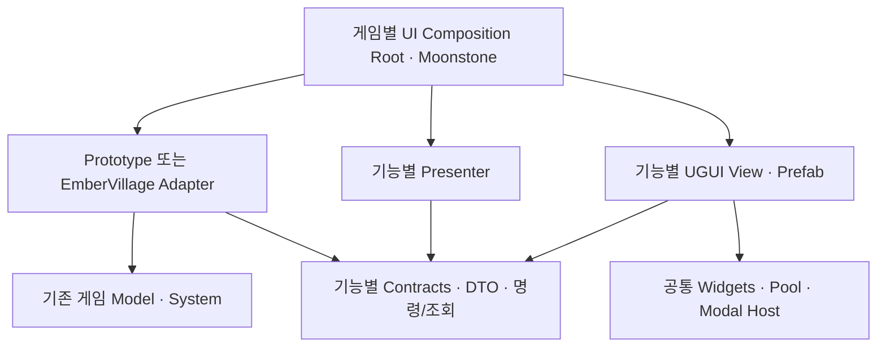

# UGUI·프리팹 중심 UI 분석 및 모듈화 설계

> 후속 요청으로 작업 범위를 `_AfterlifePrototype` 및 직접 호출하는 UI로 한정했다. 현재 범위의 결론은 [Prototype 전용 분석](afterlife-prototype-ui-design.md)을 우선한다. 최신 소스에서는 `PrototypeProgressionUi`가 `UpgradeTreeScreen`을 실제 호출하므로, 아래 초기 분석의 호출처 미확인 설명은 더 이상 유효하지 않다.

분석일: 2026-09-19. 이 문서는 설계안이며 런타임 코드·씬·프리팹은 변경하지 않았다.

## 1. 결론과 분석 범위

**고정 화면 구조는 프리팹으로 작성하고, 가변 목록은 항목 프리팹을 생성하며, 게임 연결은 화면별 Presenter와 Adapter로 분리한다.** 프리팹 Instantiate까지 없애는 것은 목표가 아니다. 편집 가능한 모양·배치와 실행 중 바뀌는 데이터·개수를 분리하는 것이 목표다.

프로젝트에는 서로 다른 UI 계열이 공존한다. 아래 소스 경로는 `impls/unity/Afterlife/` 기준이다.

| 계열 | 확인한 상태 | 적용 판단 |
|---|---|---|
| `Assets/02_Scripts/UI` | UGUI View/Screen/Controller, 직렬화 참조와 항목 프리팹 사용. `Core/UIManager`는 ServiceLocator로 화면·Controller 등록 | 기존 자산 재사용. 전역 서비스 의존성을 새 모듈로 옮기지 않는다 |
| `Assets/_AfterlifePrototype` | 저장된 Canvas, 공통/모달 프리팹, 건설·유물 항목 프리팹 사용. UI 로직은 `PrototypeView` partial 클래스에 집중 | 프리팹 기반은 유지하고 기능별 로직을 분리 |
| `Assets/_EmberVillage/Scripts/MVP/Runtime/UI` | 8개 Overlay가 IMGUI `OnGUI` 사용 | 제품 UI를 UGUI로 전환할 때 실질적인 화면 재작성 대상 |
| `Assets/Afterlife/Modules/Progression.Unity` | `UpgradeTreeScreen.Bind`가 UGUI 계층·컴포넌트를 코드로 생성 | 사용 경로를 연결하기 전에 프리팹 구조로 전환 |

씬 YAML의 스크립트 GUID 직접 참조를 확인했을 때 PrototypeCanvas/View는 `Afterlife_PixelPrototype.unity`, MVP Overlay 8개는 `MVP.unity`에서 발견된다. 현재 `EditorBuildSettings.asset`의 활성 씬은 `Main`, `Basecamp`, `Game`이다. 따라서 발견된 모든 코드가 현재 빌드에서 실행된다고 단정할 수 없다. 프리팹을 경유한 간접 사용이나 런타임 로딩은 별도 확인 대상이다.

`UpgradeTreeScreen`은 Assets 내 C# 검색에서 외부 호출처를 발견하지 못했고, 해당 `.cs.meta`도 없다. 생성 코드의 존재는 확인했지만 현재 씬에 연결된 기능이라고 보지는 않는다.

분석 방법: 프로젝트 자체 코드의 `new GameObject`, `AddComponent`, `Instantiate`, `OnGUI`, 커스텀 UI 메시 생성 검색, 호출부·씬·프리팹·asmdef 대조. 외부 에셋 패키지는 전환 대상에서 제외했다. Graphify는 Prototype Runtime 47개 코드 파일만 AST 추출했다(722 노드, 1,820 엣지, 의미 추출 없음). 그래프는 관계 탐색 보조로 사용하고 구체적인 동작은 소스로 재확인했다. 분석 캐시는 저장소 루트의 `res/analysis/ui-audit/graphify-out`에 있다. 이 수치는 전체 프로젝트 그래프 수치가 아니다. Graphify 의미 추출 LLM 토큰 비용은 0이며 대화 분석 토큰은 포함하지 않는다.

## 2. 동적으로 작성되는 UI 목록

### A. UI 계층 자체를 런타임에 조립하는 코드

**`Assets/Afterlife/Modules/Progression.Unity/UpgradeTreeScreen.cs:30` — 최우선 구조 개선 대상, 실제 채택 시 적용**

- `Bind`: 배경, viewport, 마스크, 트리 content, 중심 노드, 제목, 보유 재화, 설명, 닫기·중앙 복귀·환생 버튼 생성.
- 노드 수에 따라 버튼·텍스트·hover 컴포넌트를 만들고, 부모 관계에 따라 Image 연결선 생성.
- `MakeRect:122`, `Label:126`, `MakeButton:131`에서 GameObject 및 TMP/Image/Button 추가.
- 크기, 여백, 앵커, 색, 폰트 설정까지 코드가 소유. `Update`는 약 0.1초마다 서비스 상태를 읽는다.
- `Bind`에서 기존 계층·딕셔너리를 정리하지 않으므로 재바인딩 계약도 명확히 해야 한다.

전환: `UpgradeTreeScreen.prefab`에 고정 계층을 저장한다. 가변 요소만 `UpgradeNode.prefab`, `UpgradeEdge.prefab`에서 생성한다. 노드 좌표와 선의 길이·각도 계산은 데이터에 따라 달라지므로 코드에 남긴다. 구매 가능 여부와 구매 실행은 Presenter/서비스에 둔다.

### B. IMGUI로 화면을 매번 그리는 코드

아래 코드는 UGUI GameObject를 생성하는 코드가 아니라 `GUI`/`GUILayout` 호출로 화면을 그리는 코드다. 프리팹 편집의 이점을 얻으려면 UGUI View로 바꾸어야 한다.

기준 폴더: `Assets/_EmberVillage/Scripts/MVP/Runtime/UI/`.

| 파일·OnGUI 시작 줄 | 현재 역할 | 권장 분리 |
|---|---|---|
| `EmberConstructionPaletteOverlay.cs:38` | 건물 버튼, 취소, 배치 불가 이유·피드백 | Construction 화면 + BuildItem 목록 + 배치 피드백 |
| `EmberRunHudOverlay.cs:43` | 목표, 결과, 정산, 재시작·베이스캠프 이동 | Objectives HUD / Result 모달 / 게임 흐름 Adapter |
| `EmberProgressionOverlay.cs:40` | 베이스캠프, 이점 선택, 강화 구매, 정산, 출정 준비 | Basecamp / Upgrades / AdvantageSelection 화면 |
| `EmberCampfireWarningOverlay.cs:25` | 모닥불 경고 | Warning View |
| `EmberEnemyStatusOverlay.cs:25` | 적 상태·체력, 월드 좌표를 화면 좌표로 변환 | WorldStatus 모듈 + EnemyStatus 항목 |
| `EmberBuildingSiteLabelOverlay.cs:31` | 건설 현장 라벨 | WorldStatus 모듈 + BuildingStatus 항목 |
| `EmberWorkerLabelOverlay.cs:21` | 일꾼 패널·작업 대상 라벨 | Workers 패널 / WorldStatus 항목 |
| `EmberRunDebugOverlay.cs:37` | 자원, 진행 상태, 시스템 진단 | 별도 Debug 모듈 |

추가: `Assets/_EmberVillage/Scripts/Demo/Runtime/Field/UI/EmberFieldDebugPanel.cs:25`, `Assets/_AfterlifePrototype/Runtime/PrototypeHud.cs:22`도 IMGUI다. Prototype 디버그 패널에는 `UNITY_EDITOR || DEVELOPMENT_BUILD` 조건이 있다. MVP Debug Overlay는 같은 컴파일 조건 없이 `_showOverlay`로 표시를 제어하므로 배포용 포함 여부를 명시해야 한다.

`EmberEnemyStatusOverlay`는 `_autoFindEnemies`가 켜지면 `OnGUI` 안에서 `FindObjectsByType`를 수행한다. 새 구조에서는 적 생성·제거 통지를 받아 항목을 등록하고, 위치만 표시 주기에 갱신한다.

### C. 이미 프리팹을 사용하는 정상적인 가변 UI

| 파일 | 생성 대상·방식 | 개선할 책임 |
|---|---|---|
| `Assets/_AfterlifePrototype/Runtime/PrototypeBuildMenuItems.cs:12,40` | Catalog의 `ItemPrefab` 복제, 건물별 이름·가격·아이콘 설정 | ConstructionList View에 항목 관리, Presenter에 상태·명령 처리 |
| `Assets/_AfterlifePrototype/Runtime/PrototypeRelicHud.cs:42,56` | 소유 유물 ID에 따라 `ListItemPrefab` 생성·제거 | RelicHud 모듈로 분리, typed Image 참조 및 포인터 이벤트 |
| `Assets/02_Scripts/UI/Main/Life.cs:11` | 생명 수만큼 Soul 프리팹, 기존 항목 전체 제거 후 재생성 | 개수 차이만 반영; 잦은 변경일 때 재사용 |
| `Assets/02_Scripts/UI/Progress.cs:25,43` | 진행 노드·연결선 프리팹 | 구조 생성과 진행 상태 갱신 분리 |
| `Assets/02_Scripts/UI/Stage/DayProgress.cs:53,57` | 일차 노드·연결선 프리팹 | Timeline View로 캡슐화 |
| `Assets/02_Scripts/UI/Stage/Skill.cs:26,30` | SkillSlot 프리팹과 클릭 이벤트 | 항목별 ID·리스너 수명 관리 |
| `Assets/02_Scripts/UI/Stage/ItemInformation.cs:37` | 제작 요구 재료 슬롯 프리팹 | ItemDetails 표시 데이터와 레이아웃 분리; 높이 200/290 하드코딩 정리 |
| `Assets/02_Scripts/Dev/UpgradeTree/UI/UpgradeTreeView.cs:80,191` | 업그레이드 노드·연결선 프리팹 | 프리팹 구성은 참고하되 Dev 의존성은 가져오지 않는다 |
| `Assets/02_Scripts/GameSystem/Stage/ItemCollectSystem.cs:55` | 획득 팝업 프리팹 | 게임 시스템의 직접 UI 생성 대신 획득 이벤트 → Feedback Presenter |

건설 목록은 `LayoutGroup`이 없을 때 직접 Y 위치와 content 높이를 계산한다. 프리팹에 레이아웃을 명시하고 런타임 대체 배치를 제거하는 편이 일관적이다. 유물 목록은 이미 ID 기반 차이 반영을 하므로 이 동작을 보존한다.

목록마다 풀을 만들 필요는 없다. 시작 시 한 번 만드는 건설 목록은 일반 Instantiate면 충분하다. 짧게 나타나고 빈번하게 재사용되는 데미지 숫자·획득 연출·대량 상태 라벨에 우선 적용한다.

### D. 보완 생성·렌더링·에디터 생성의 구분

- `PrototypeUgui.cs:24,124,198`: DayStartBanner, DisabledButtonSound, CanvasGroup이 없으면 추가한다. 정규 프리팹에 미리 부착하고 누락은 에디터 검증으로 발견한다.
- `PrototypeTileBuildMenu.cs:47`, `PrototypeDayStartBanner.cs:46`, `PrototypeModalBackdrop.cs:54,111`: CanvasGroup 보완 추가도 같은 전환 대상이다.
- `PrototypeModalBackdrop.cs:94`: 블러 캡처 Camera 생성은 렌더링 인프라다. 전용 효과 모듈이 카메라·Material·RenderTexture 수명을 소유하게 하고, 화면별 Presenter에서는 제거한다.
- `PrototypeUgui`의 데미지/기여 숫자 `Amounts`, 채집 연출 `CollectionIcons`, 일차 `DayTick`은 미리 연결된 항목의 활성·위치·값을 갱신한다. 매 프레임 UI 계층을 새로 만드는 것으로 분류하지 않는다.
- `PrototypeUiSymbol`, `ProgressionBackdrop`, `02_Scripts/UI/LineRenderer`는 `MaskableGraphic` 등의 UI 메시를 계산한다. 프리팹에 부착 가능한 시각 컴포넌트이므로 절차적 렌더링을 무조건 제거할 필요는 없다. 고정 아이콘만 Sprite 대체를 검토한다.
- `Prototype*Migration` 등 Editor 스크립트의 생성·`SaveAsPrefabAsset`는 편집 단계 작업이다. 런타임 생성과 구분하고, 전환 이후에는 프리팹을 계속 덮어쓰는 경로가 없는지 확인한다.
- 월드 타일 마커·공격 범위 LineRenderer·건물 Mesh 생성은 이번 화면 UI 전환의 직접 대상이 아니다.

## 3. 프리팹만 바꾸어서는 해결되지 않는 결합

1. **partial 파일 분리는 모듈 분리가 아니다.** PrototypeView는 월드 생성·입력·오디오·UI·모달·모델 명령을 동일 인스턴스에서 공유한다. UI Presenter를 별도 타입과 assembly로 옮겨야 접근 가능한 의존성이 줄어든다.
2. **문자열 전역 레지스트리 결합.** `PrototypeCanvas.Bindings`와 `PrototypeUgui.UiClick`은 `Build.Item.*`, `Recruit.*` 등을 해석한다. 새 기능이 Canvas 등록·중앙 분기·중앙 갱신 모두를 수정하게 한다. `PrototypeModalPanel.Connect`도 내부 참조를 전역 목록에 합친다.
3. **게임 로직 역방향 참조.** ItemCollectSystem은 UI Controller를 찾아 Refresh하고 팝업을 생성한다. 게임은 재화 변경·획득 사실만 통지하고 UI가 표시를 결정하도록 바꾼다.
4. **씬 검색·Resources 관례 의존성.** 일부 Overlay의 FindFirstObjectByType, 유물의 이름 기반 루트 검색, Catalog의 Resources fallback은 단독 화면 실행을 어렵게 한다. 조립 계층에서 명시적으로 주입한다.
5. **전역 갱신 루프.** PrototypeUgui.LateUpdate는 모달·툴팁·타임라인·재화·버튼·전투 연출을 함께 갱신한다. 기능별 갱신과 표시 수명을 나누어 숨긴 화면은 불필요한 작업을 멈춘다.
6. **구독 수명.** PrototypeCanvas.Bind는 AddListener를 추가하며 대응하는 Unbind가 없다. 현재 초기화 1회 경로와 별개로, 재사용·재바인딩을 도입할 때 중복 실행 위험이 있다. 모델 구독을 해제하는 기존 OnDestroy 동작은 보존한다.

## 4. 목표 모듈과 의존성 방향

공통 UI에는 게임 규칙을 넣지 않는다. 기능별 모듈은 자신에게 필요한 계약을 정의하고, 게임 쪽 Adapter가 그 계약을 구현한다. 화면 간 요청은 명시적인 이벤트/조정 계약으로 연결한다.



화살표는 컴파일 의존 방향이다. Root가 인터페이스를 통해 Presenter와 View/Adapter를 연결한다. Presenter는 구체적인 UGUI View 타입을 몰라도 작동한다. 게임 모델은 UI 모듈을 참조하지 않는다.

| 모듈 | 소유 책임 | 참조하지 않아야 할 것 |
|---|---|---|
| `UI.Contracts` | 화면 수명, 모달 요청·결과 등 최소 공통 계약 | Unity, 구체 게임, 모든 기능의 DTO |
| `UI.UGUI` | 공통 버튼·툴팁 표면, 항목 재사용, ModalHost, 입력 차단 | VillageModel, EmberRunController, 건설·강화 규칙 |
| `UI.Hud` | 재화·인구·일차·알림 표시 | Construction Presenter, 게임 객체 직접 검색 |
| `UI.Construction` | 건설 목록·선택 상태·배치 사유 표시 | 월드 생성, 자원 차감 구현 |
| `UI.Relics` | 유물 목록·툴팁 데이터 표현 | VillageModel 정적 효과 계산 |
| `UI.Barracks` | 모집·대기열·취소 UI | 유닛 스폰, 생산 시뮬레이션 |
| `UI.Upgrades` | 트리 선택·설명·구매 요청·노드 상태 | 재화 저장소·게임별 건물 조건 구현 |
| `UI.RunFlow` | 목표·정산·결과 화면 | SceneManager 직접 호출 |
| `UI.Basecamp` | 이점·준비·출정 UI | 세이브·진행 규칙 구현 |
| `UI.WorldStatus` | 대상 등록·위치 투영·상태 라벨 재사용 | 적 탐색·AI·체력 변경 |
| `UI.Feedback` | 획득·데미지 숫자·배너 연출 | 실제 보상 지급 |
| `UI.Settings` / `UI.Debug` | 설정 화면 / 개발 진단 | 다른 화면 내부 필드 |
| 게임별 `UIIntegration` | Adapter, Root, 모듈 간 화면 흐름 연결 | 게임 규칙 중복 구현 |

권장 폴더 예:

```text
Assets/Afterlife/UI/
  Contracts/
  UGUI/Runtime/  Prefabs/
  Features/Construction/
    Presentation/   # 순수 C#: IConstructionUiPort, 상태 DTO, Presenter, View 계약
    UGUI/           # ConstructionView, BuildItemView
    Prefabs/        # ConstructionPanel, BuildItem
    Data/           # 아이콘·문구 등 표시용 ScriptableObject
  Features/Relics/ ...
  Features/Upgrades/ ...
  Integration/Prototype/
  Integration/EmberVillage/
```

독립 개발/재사용 대상인 기능부터 `Afterlife.UI.Construction.Presentation`과 `.UGUI`로 asmdef를 나눈다. Presentation은 `noEngineReferences: true`, UGUI는 해당 Presentation·공통 UGUI·UGUI/TMP만 참조한다. Integration은 게임 구현과 기능들을 참조한다. 다른 기능의 UGUI assembly를 참조하지 않는다. 처음부터 위 표의 모든 작은 화면을 별도 assembly로 만들 필요는 없다.

기존 `Afterlife.Upgrades`, `Afterlife.Skills`의 순수 C# 경계는 유지한다. 신규 UI의 사용 권한·재화·구매 계약을 Adapter에서 기존 서비스와 연결한다. `Afterlife.Progression.Unity` 전체를 공통 UI 기반으로 삼지는 않는다.

Moonstone의 실제 Container는 구체 객체 등록 및 주입 형태다. 가상의 DI API를 도입하지 않고 Root가 Adapter를 등록/해석한 후 Presenter 생성자에 명시적으로 전달하는 방식으로 시작한다. UI 내부에는 컨테이너를 전달하지 않는다.

기존 `02_Scripts/State/StateMachine`, `Mode/ModeSystem`의 전환/입장/퇴장 흐름을 우선 활용하되, 이들은 `Afterlife.Dev.*`에 있으므로 새 공통 UI assembly가 직접 의존하지 않게 Integration Adapter로 감싼다. 게임 진행 상태, 건설 상호작용 모드, 모달 스택은 각각의 책임을 유지한다.

## 5. 프리팹 구성과 런타임 계약

```text
UIRoot.prefab
  HudLayer
  WorldStatusLayer
  PanelLayer
  ModalLayer
    Backdrop
    ModalContainer
  TooltipLayer
  FeedbackLayer
```

레이어는 정렬·입력 우선순위 경계다. 처음부터 모든 레이어를 별도 Canvas로 만들지는 않는다. 변동 빈도와 실제 갱신 비용에 따라 Canvas를 나눈다. CanvasScaler 및 루트 EventSystem은 조립 계층에서 일관되게 구성한다.

- 정적 패널은 프리팹 자체에 TMP, Image, Button, LayoutGroup, CanvasGroup, 마스크와 직렬화 참조를 저장한다.
- 공통 `Framed View`, `Titled View`, `Tooltip`, 기존 모달 프리팹은 시각 기반으로 재사용한다. 공통 프리팹에는 게임 Controller를 넣지 않는다.
- 모달 공통 외형은 nested prefab/variant로 공유하고 Barracks·Research·Result의 기능 View는 각자 가진다. 거대한 공통 모달 스크립트의 기능 분기로 확장하지 않는다.
- 화면 내부는 `[SerializeField] private Button _cancelButton` 같은 typed 참조를 사용한다. 문자열 ID는 데이터의 식별자에만 사용하고 계층 경로·동작 파싱에는 사용하지 않는다.
- 가변 목록은 View가 자신의 content와 항목 프리팹을 소유한다. Presenter는 GameObject가 아닌 항목 ID와 표시 DTO를 전달한다.
- ScriptableObject에는 표시 자산·테마·문구 키를 둔다. 현재 선택, 보유량, 모달 스택, 구독자 같은 실행 상태는 넣지 않는다. 가격·해금의 권위는 게임 서비스에 둔다.
- Resources.Load fallback은 전환 기간에 Integration에만 남기고 최종적으로 직렬화된 참조/명시적 자산 공급자로 대체한다.

건설 UI 계약 예시(설계 예이며 구현 코드는 아님):

```csharp
public interface IConstructionUiPort
{
    ConstructionUiState Read();
    event Action Changed;
    BuildRequestResult RequestBuild(BuildingId id, PlacementTarget target);
}

public interface IConstructionView
{
    event Action<BuildingId> BuildRequested;
    void Render(ConstructionUiState state);
}
```

BuildingId와 PlacementTarget은 계약 모듈의 값 타입이다. VillageModel의 Kind/Point를 공통 UI로 노출하지 않고 Prototype Adapter에서 변환한다. 클릭 시 Presenter는 표시 당시의 가격을 신뢰해 차감하지 않고 명령을 보낸다. 서비스가 현재 상태로 재검증하고 성공/실패 이유를 반환하며, Presenter는 최신 상태를 다시 읽는다.

수명 계약:

1. `Initialize`: 프리팹 필수 참조 검증 및 불변 의존성 연결. Awake/OnEnable에서는 주입된 서비스가 있다고 가정하지 않는다.
2. `SetUp/Show`: View 이벤트·모델 변경 구독, 즉시 최신 snapshot 표시. 반복 호출 시 중복 구독 방지.
3. `Hide/TearDown`: 자신이 등록한 리스너만 해제하고 transient 상태·실행 중 연출 정리. 풀 항목의 ID, tooltip, 선택, alpha도 초기화.
4. `Dispose`: 생성 항목·모듈이 소유한 렌더 자원 해제. Moonstone 기반 컴포넌트에서는 `OnInitialize → OnSetUp → OnTearDown` 순서에 맞춘다.

상태 변경 이벤트는 기능별로 제공한다. 아직 이벤트가 없는 모델은 Adapter에서 한시적으로 상태를 비교해 통지한다. 모든 화면이 각자 모델 전체를 폴링하지 않도록 한다. 타이머·게이지·좌표·애니메이션은 필요한 표시 주기로 계속 갱신하되 프리팹을 재생성하지 않는다.

## 6. 모달·입력·연출 정책

- ModalHost는 열기/닫기/최상위/포커스/뒤로가기/배경 차단만 소유한다. 구매·연구·환생 조건은 소유하지 않는다.
- 최상위 모달만 interactable/blocksRaycasts를 켠다. 배경 효과를 꺼도 뒤 UI로 클릭이 통과하지 않도록 차단 표면은 유지한다.
- 일시정지는 게임 흐름 Adapter가 적용한다. 중첩 모달은 이유별 토큰/카운트로 관리해 하나를 닫았다고 나머지 모달의 정지가 풀리지 않게 한다. 닫기·파괴·씬 종료 시 토큰 반환.
- 선택/건설/드래그는 기존 모드 시스템과 연결한다. UI 포인터 차단을 별도 계약으로 제공해 게임 입력이 패널 타입을 알 필요가 없게 한다.
- 월드 상태 라벨의 대상은 등록·해제로 관리한다. 투영기는 카메라 뒤/화면 밖 대상 숨김, 대상 소멸 시 항목 반환을 처리한다.
- Prototype은 월드를 RawImage의 RenderTexture로 표시하므로 화면 전체 기준 WorldToScreenPoint만 적용하면 위치가 달라질 수 있다. 기존 WorldDisplay 사각형을 통한 좌표 변환을 해당 게임의 투영 Adapter가 보존한다.
- 재화 획득 연출은 실제 지급과 분리한다. 현재처럼 모델은 즉시 지급하고 표시만 지연한다. 연출 취소·풀 부족·화면 닫기 이후에도 HUD가 실제 잔액으로 수렴해야 한다.
- 블러 효과는 독립 컴포넌트로 분리하고 종료 시 capture coroutine, Camera, Material, RenderTexture를 함께 정리한다.

## 7. 점진적 전환 순서

| 단계 | 변경 | 완료 기준 |
|---|---|---|
| 0 | 목표 씬·화면 소유자 확정, 기존 화면/프리팹 연결 기록 | Prototype, MVP, 기존 Main의 경로를 혼합하지 않음 |
| 1 | Prototype 건설 목록을 첫 수직 기능으로 분리 | 기존 Build.Item 외형 유지; Construction Presenter/View/Adapter만으로 목록·명령 동작 |
| 2 | 유물 HUD 분리, typed 항목 참조 도입 | 획득·제거·툴팁·재오픈 동작, Canvas 전역 binding에서 해당 기능 제거 |
| 3 | ModalHost 및 Barracks 등 기능별 Presenter 도입 | 최상위 입력·중첩 닫기·정지 복원이 동일하게 동작 |
| 4 | 채택하는 UpgradeTreeScreen을 고정 프리팹 + 노드/선 프리팹으로 전환 | Bind의 고정 계층 생성 제거, 잠금·구매·pan/zoom 유지 |
| 5 | 사용 대상인 MVP IMGUI를 기능 단위로 교체 | 건설 → HUD/결과 → 진행/베이스캠프 → 월드 상태 순; 구·신 UI 중복 실행 없음 |
| 6 | 레거시 목록·획득 팝업의 Adapter 연결, fallback 정리 | ServiceLocator/Find/이름 탐색이 새 View에 없음; 기존 프리팹 수정이 런타임에도 유지 |

전환 기간에는 화면 하나당 기존 구현과 새 구현 중 하나만 활성화한다. PrototypeCanvas 문자열 API는 미전환 화면에만 남기고, 새 모듈을 그 레지스트리로 되돌려 연결하지 않는다. 기능 이관이 끝날 때 해당 UiClick 분기와 LateUpdate 갱신을 함께 제거한다.

우선순위는 실제 사용하는 씬에 따라 다르다. Prototype을 계속 개발한다면 1~3이 먼저다. EmberVillage MVP를 채택한다면 5의 핵심 화면을 앞당긴다. 호출이 확인되지 않은 UpgradeTreeScreen 때문에 현재 사용 화면의 전환을 지연하지 않는다.

## 8. 검증 계획과 이번 작업의 변경

이번 작업은 정적 분석·설계 문서 작성 및 분석 캐시 생성만 수행했다. 런타임 코드, 씬, 프리팹, asmdef, `.meta`는 수정하지 않았다. 코드 변경이 없으므로 빌드 및 Unity 에디터 테스트는 실행하지 않았다.

구현 단계의 자동 검증은 저장소 지침에 따라 생성된 관련 `.csproj`의 `dotnet build --no-restore`로 제한한다. Unity Test Runner/EditMode/PlayMode 테스트는 에이전트가 실행하지 않는다.

사용자가 구현 후 Unity에서 확인할 절차:

| 대상 | 절차 | 기대 결과 |
|---|---|---|
| 프리팹 편집성 | Prefab Mode에서 배치·색·폰트 변경 후 대상 씬 실행 | 코드가 편집한 고정 외형을 덮어쓰지 않음 |
| 재바인딩 | 화면을 여러 번 열고 닫은 뒤 구매/취소 1회 | 명령·효과음·구독이 중복 실행되지 않음 |
| 독립성 | 기능 프리팹을 전용 확인 씬에 배치하고 Fake Port 연결 | 전체 게임 Bootstrap 없이 표시·입력 확인 가능 |
| 목록 | 0개, 1개, 다수, 제거, ID 동일 상태 변경 | 중복 항목 없음, 레이아웃·빈 상태 정상 |
| 모달 | 두 모달 중첩 후 순차 닫기, 뒤 버튼/월드 클릭 시도 | 최상위만 입력 수신, 정지는 마지막 관련 토큰 해제 시 복원 |
| 명령 검증 | 표시 이후 재화/조건을 변경하고 버튼 클릭 | 게임 규칙이 재검증하고 실패 사유 표시 |
| 투영 | 창 크기·UI 배율·월드 표시 영역 변경, 대상 제거 | 라벨·피드백 위치 일치, 남은 항목 없음 |
| 자원 수명 | 모달 블러 중 닫기·씬 전환, 획득 연출 중 초기화 | 임시 렌더 자원 정리, 잔액 표시 실제 값으로 복원 |

변경 전에는 분석 결과와 독립 모듈 경계가 이 문서로 정리되어 있지 않았다. 변경 후에는 동적 UI의 유형·소유 파일·전환 대상, 계약/asmdef 방향, 프리팹 책임, 단계별 완료 기준을 함께 검토할 수 있다.
